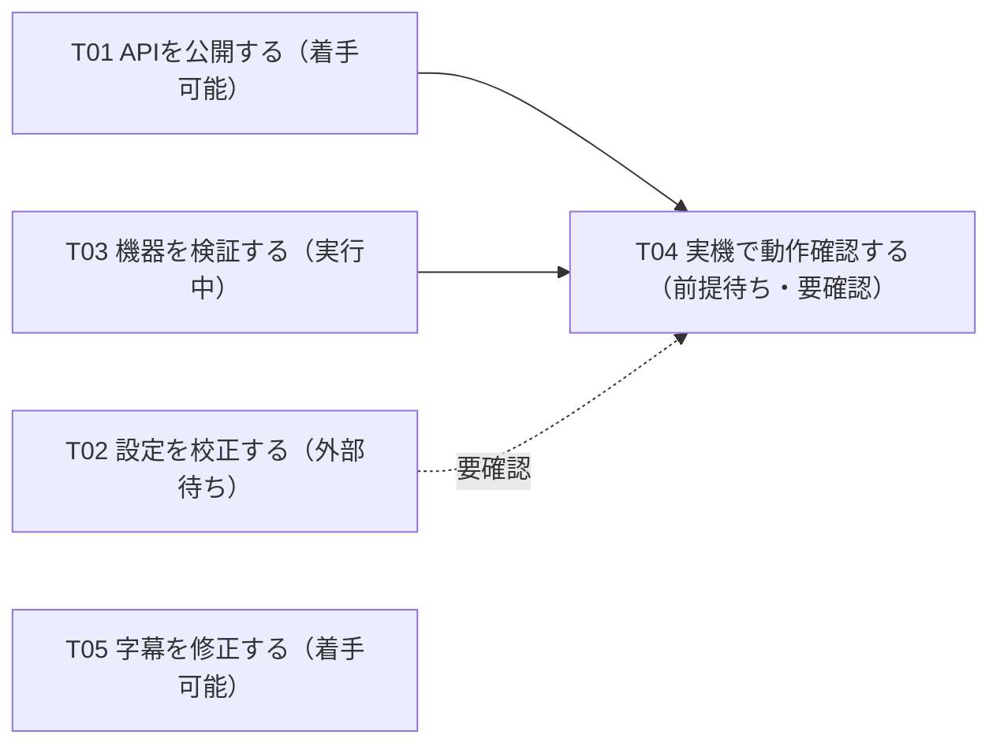

# 出力形式と記入例

見出しは次の五つをこの順で使う。中括弧は説明用の差し込み位置であり、実際の出力には残さない。架空の例の作業・判断を実際の会話へ流用しない。

## 固定テンプレート

````markdown
## 確認範囲

確認日時：{日時・タイムゾーン}。対象：{期間・プロジェクト等}。
本文確認：{通常対象のチャット件数}件、依存先の追加確認：{件数}件。未完了作業：{件数}件。
制約：{上限到達・取得失敗・未確認範囲。なければ「なし」}。

## 次にすること

- **最初に進める**：{作業ID・短い動作名と理由。なければ「なし」}。
- **並行して進める**：{作業ID同士の組み合わせと両立できる根拠。未確認ならその旨。なければ「なし」}。
- **待つ**：{作業ID・何を待つか・解除条件。なければ「なし」}。

## 依存関係図

{Mermaidのflowchart LR。非対応なら矢印付きテキスト。対象なしなら「なし」}

凡例：実線は必須の前提 → 後続、破線「要確認」は未確認の依存候補。線がないだけでは並行可能とは限らない。競合は作業一覧を参照。

## 作業一覧

| ID | 作業・出典 | 現在の状態 | 着手条件・競合 | 次の一手 |
| --- | --- | --- | --- | --- |
| {T01} | {作業名・正式なチャット名と参照} | {状態} | {前提ID・具体的な成立条件・競合相手ID。なければ「なし」} | {誰が何を確認・実施するか} |

## 未確認事項

{作業ID・関係、判断に足りない情報、確認方法を列挙。なければ「なし」}
````

作業一覧は推奨する着手順に並べる。根拠の詳細が必要なら該当する表のセルへ発言の時点や短い要旨を添え、別の調査ログを増やさない。秘密情報や無関係な会話内容を転載しない。

## 記入例（架空）

次はMermaid・表の整合と、依存候補・競合の区別を示す例。出典IDも架空であり、実際には取得した参照に置き換える。

## 確認範囲

確認日時：2026-11-24 15:00 JST。対象：過去7日間・プロジェクト横断。
本文確認：5件、依存先の追加確認：0件。未完了作業：5件。
制約：なし。

## 次にすること

- **最初に進める**：T01 APIを公開する。T04の実機確認に必要な接続先を確定できる。
- **並行して進める**：T01とT05。APIはサーバー、字幕はローカルの動画ファイルが対象で、確認した作業範囲では共有資源がない。T03とT05も並行できる。
- **待つ**：T02はT03が検証用機器を解放するまで待つ。T04はT01・T03の完了と、T02の成果が必要かの確認を待つ。

## 依存関係図



凡例：実線は必須の前提 → 後続、破線「要確認」は未確認の依存候補。線がないだけでは並行可能とは限らない。競合は作業一覧を参照。

## 作業一覧

| ID | 作業・出典 | 現在の状態 | 着手条件・競合 | 次の一手 |
| --- | --- | --- | --- | --- |
| T01 | APIを公開する。出典：「デバイスAPIの公開」（chat-api） | 着手可能 | なし | 担当者が確認済みの手順でAPIを公開する |
| T03 | 機器を検証する。出典：「検証用機器の動作確認」（chat-device） | 実行中 | T02と検証用機器が競合。現在T03が使用中 | 担当者が検証結果と機器の解放を報告する |
| T05 | 字幕を修正する。出典：「動画の字幕修正」（chat-video） | 着手可能 | ローカルの字幕ファイルのみを編集。T01・T03との競合なし | 担当者が指摘箇所を修正する |
| T02 | 設定を校正する。出典：「センサーの設定校正」（chat-calibration） | 外部待ち | T03と同じ検証用機器を使用。機器の解放で着手可能 | 担当者が機器の空きを確認する |
| T04 | 実機で動作確認する。出典：「実機での受入確認」（chat-acceptance） | 前提待ち・要確認 | T01でAPI接続先確定、T03で機器検証完了。T02の校正が必須かは未確認 | 担当者が受入条件に校正が含まれるか確認する |

## 未確認事項

- **T02 → T04**：受入確認に校正済み設定が必要か不明。「実機での受入確認」の受入条件を確認し、記載がなければユーザーに判断を求める。確認するまで、この組み合わせを並行可能とは断定しない。

## 特殊な場合も同じ構成にする

- **循環依存**：循環を図に残し、「次にすること」に解消すべき確認、「未確認事項」に関係するIDと矛盾の根拠を記す。循環内に無理な着手順を付けない。
- **12ノード超**：まとまりごとに図を分け、図をまたぐ関係は図の直下へIDで列挙する。表は分割せず全件を掲載する。
- **Mermaid非対応**：`T01 → T04`、`T02 → T04（要確認）`、`T05（依存なし・並行可否は表を参照）`のように全作業と関係をテキストで表す。
- **対象なし**：「次にすること」の三区分はすべて「なし」、図と作業一覧も「なし」とする。未確認がなければ最後も「なし」とする。
- **取得不可**：確認範囲にアクセスできない対象と理由を示し、図や表の不明部分を補完しない。取得できないことを、未完了作業がないという結論にしない。
